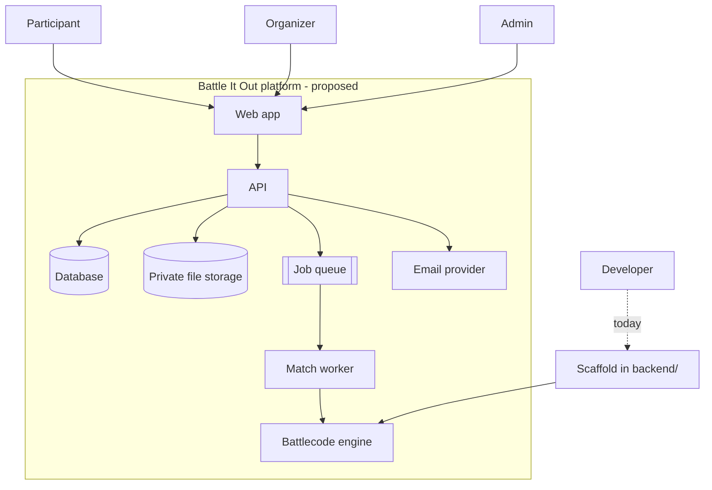
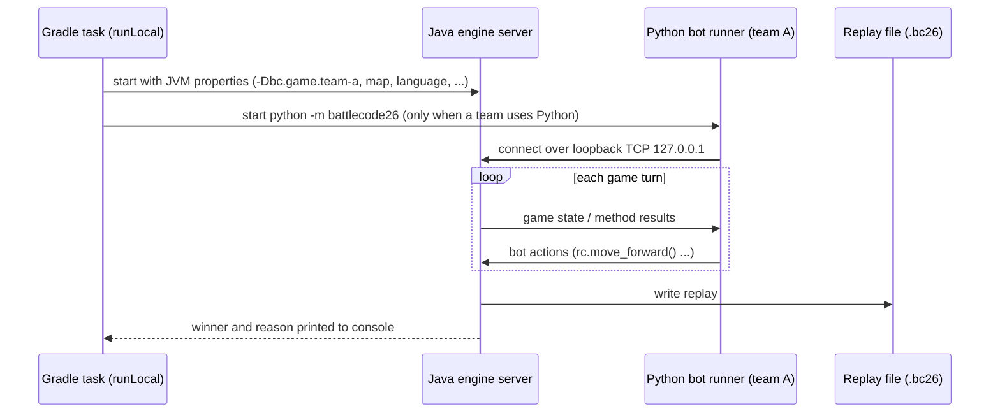
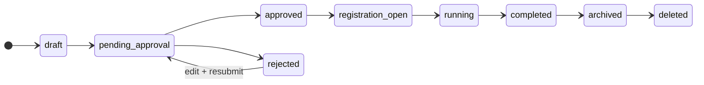
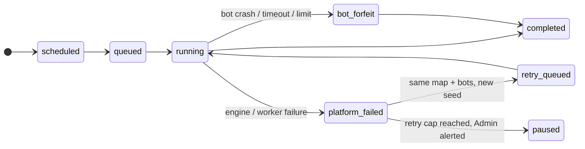
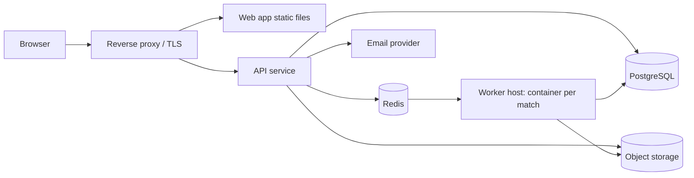

# Battle It Out --- Architecture & Design Document

**Version:** 1.0\
**Status:** Working baseline. Part 1 describes what exists in the repository today; Parts 2 to 5 describe the intended design, which is mostly proposed and not implemented.\
**Date:** 2026-11-24\
**Audience:** developers and reviewers who need to understand how the system is meant to fit together and where the real risks are.\
**Sources:** `PRD.md` (v1.1), `SRD.md`, `API_CONTRACT.md`, `DATA_MODEL.md`, `APP_FLOW.md`, `TEST_PLAN.md`, and the code under `backend/battlecode26-scaffold/` and its installed Python package.

> **Labels.** *Observed* = read in the code or reproduced by running a command on 2026-11-24. *Confirmed* = established in the requirement documents. *Proposed* = recommended, needs approval. `[DECIDE]` = unresolved. Where this document draws a conclusion from reading code rather than from a test, it says so.

## 1. System context and current state

### 1.1 What the system is

Participants submit one Python file, `bot.py`. The platform runs matches between submitted bots in the existing Battlecode 2026 engine, advances a single-elimination bracket, stores replays and results, and notifies users. Three authenticated roles use it: Participant, Organizer, Admin (see `PRODUCT.md`).

### 1.2 What exists today (Observed)

Only the execution foundation exists: the Battlecode 2026 scaffold at `backend/battlecode26-scaffold/`. There is no API, database, worker, or website.

| Element | What it is | Where |
|---|---|---|
| Java engine server | `battlecode.server.Main`, started by the Gradle task `runJavaLocal` in headless mode; simulates the game and writes a replay file (`.bc26`) | engine jar `org.battlecode:battlecode26-java` (version from `engine_version.txt`, 1.2.6 at time of writing) |
| Python bot runner | `backend/match_runner/runner_entry.py` (wraps the engine's `battlecode26.play()`), a separate process that loads `<bots dir>/<team>/*.py` and drives each bot turn | Python package `battlecode26` 1.2.2 in `backend/.venvs/py<version>`, Python 3.12 to 3.15 tested |
| Python bots | Directory `src/<team>/` containing `bot.py` with a `turn()` function | `src/examplefuncsplayer_py/bot.py` |
| Launcher | `run.py` (install/update engine package, verify a player, run cross-play, zip a submission) and `build.gradle` (build, run, version, update tasks) | scaffold root |
| Client | Desktop replay viewer, downloaded by `./gradlew build` into `client/` | optional, git-ignored |

### 1.3 How a match runs today (Observed from `build.gradle`, `run.py` and the installed package)

What was verified by running it (2026-11-24): through `backend/match_runner/launcher.py`, the example Python bot against itself finishes in about 3 seconds on Python 3.12, 3.13, 3.14 and 3.15 (team A wins in round 1290, "destroyed all of the enemy team's rat kings"; identical replay on every version). The scaffold's own Gradle task for Python bots fails on Linux (wrong `python3`, start-up deadlock; `TECHNICAL_DOCUMENTATION.md` §3.2), which is why the launcher exists. Java bots were removed (CN-002); the Java engine server is the game engine and stays.

### 1.4 The engine's Python execution model (Observed by reading `battlecode26/runner.py`, `crossplay.py`, `__main__.py`)

- A bot is the set of `.py` files in `<dir>/<team>/`. The entry file is `bot.py` and must define `turn()` (the scaffold's `verify` task only searches the file text for `def turn():`).
- Bot code is executed with **RestrictedPython** (`safe_builtins`), with source instrumented to count bytecode. When the count reaches the limit, the runner raises "Ran out of bytecode". `BYTECODE_LIMIT = 20000` is the default in `crossplay.py`, commented "updated by game", so the real per-turn budget is set by the engine at run time.
- Imports are intercepted: a bot may import its own modules, and only `random`, `math`, `enum` and `battlecode26` from outside. Anything else raises `ImportError`. Import cycles between bot modules are rejected.
- The bot process and the Java server talk over TCP on `127.0.0.1` using JSON messages (`CrossPlayClient`, `CrossPlayMethod`).
- The bot API is the names exported by `from battlecode26 import *`: `Direction`, `GameActionException`, `GameActionExceptionType`, `GameConstants`, `MapInfo`, `MapLocation`, `Message`, `RobotController`, `RobotInfo`, `Team`, `TrapType`, `UnitType`, `rc`, `log`, and helper functions such as `direction_to`, `distance_squared_to`, `is_adjacent_to`, `is_within_distance_squared`, `bottom_left_distance_squared_to`, `get_all_type_locations`.

**Reading of this code (not a test result):** the RestrictedPython and bytecode mechanism is a language-level restriction inside one process. It limits what Python code can do, and bounds computation per turn, but it is not an operating-system boundary. PRD BIO-NFR-01 asks for isolation from host services, other bots and user data, so the platform should add container-level isolation around the whole match process rather than rely on this alone (see §4.4).

## 2. Architecture principles

Derived from `PRODUCT.md` and the PRD; each has a consequence for design.

1. **Prove the engine first.** The execution path is built and tested before the website (consequence: Epics 01 to 03 gate everything).
2. **Reuse the Battlecode engine.** No second game engine (consequence: the platform wraps the engine, it does not reimplement it).
3. **Untrusted code stays out of the web process.** Bots run only in isolated workers (consequence: queue boundary between API and worker).
4. **Server-side authorization everywhere.** Role and tournament-scope checks on every protected operation (consequence: a single policy layer used by every endpoint; no UI-only rules).
5. **Immutable history.** Submissions are immutable versions, matches reference exact versions, audit is append-only, and historical results never cascade-delete (consequence: restrictive foreign keys and an outbox/audit pattern).
6. **Explicit, auditable state transitions.** Tournament, submission, match and deletion states are enumerated and checked (consequence: state machines in the service layer, §3.4).
7. **Idempotent operations.** Retried requests and duplicate worker deliveries must not duplicate results or advance a bracket twice (consequence: idempotency keys and unique constraints).
8. **Pinned and reproducible.** Python patch version, engine, client, packages, and worker image are pinned (consequence: version matrix and lockfiles).

## 3. Logical architecture (proposed)

### 3.1 Components

| Component | Responsibility | Proposed technology (DEC-11, unapproved) |
|---|---|---|
| Web app | Participant, Organizer and Admin interfaces; polling for updates | React + TypeScript |
| API | Authentication, authorization, tournament/roster/submission/match endpoints, audit, notification events | Django + Django REST Framework |
| Database | System of record for identities, tournaments, teams, submissions, matches, audit, notifications | PostgreSQL |
| Job queue and scheduler | Hands match, validation, replay-purge and notification jobs to workers; retries | Celery + Redis |
| Match worker | Validates submissions and executes one match attempt per job inside isolation; reports a structured result | container workers wrapping the Battlecode engine |
| File storage | Private submissions, replays, logs; short-lived authorized access only | S3-compatible private storage |
| Email provider | Notification delivery with attempt tracking | `[DECIDE]` |
| Reverse proxy / hosting | TLS and routing for containerized services | `[DECIDE]` |

Realtime updates start as polling; WebSockets only if live updates are later approved (DEC-09 recommends deferring live viewing).

### 3.2 Module boundaries inside the API

| Module | Owns | Epic |
|---|---|---|
| `identity` | users, roles, organizer assignments, sessions, notification preferences | 04 |
| `tournaments` | tournaments, approvals, deadlines, settings, maps, archive | 06 |
| `roster` | roster import, invitation codes, teams, members | 05 |
| `submissions` | uploads, versions, validation records, active-version selection | 05 |
| `matches` | rounds, brackets, matches, attempts, replays, logs, house bots | 03 |
| `notifications` | in-app feed, delivery records, email outbox | 06 |
| `audit` | append-only audit events, scoped read access | 04 |
| `policy` | one place that answers "may this user do this to this object?" | 04 |

### 3.3 Data architecture

The logical model is in `DATA_MODEL.md`; the principles that drive the design:

- Separate account identity, official roster identity, team membership, and tournament participation.
- `BotSubmission` rows are immutable (content hash, version number); a `Match` stores two submission ids, never "latest".
- `MatchAttempt` records each execution (seed, profile, failure class, resource usage, worker version); `Match` holds the final result and result type (`normal`, `bot_forfeit`, `tiebreak`, `coin_flip`, `platform_abort`).
- Replay binaries are disposable artifacts; archive deletes the file and keeps the metadata.
- `AuditLog` is append-only and permanent, with redacted before/after payloads and a pseudonymous actor after account deletion.
- Foreign keys use `RESTRICT` or explicit service-level archival for historical records; no blind cascade.

### 3.4 State machines (from `DATA_MODEL.md` §4)

The `paused` name and who may resume a paused match are `[DECIDE]` (the data model leaves the final state name open).

Submission states are `uploaded -> validating -> valid -> active` or `uploaded -> validating -> invalid`. Account deletion is `requested -> queued -> scheduled -> executed`, with `cancelled` as an alternative.

## 4. Key flows and design decisions

### 4.1 Submission and validation

1. Participant uploads exactly `bot.py` (idempotency key supplied). The API checks authorization, deadline, filename, type and size, then stores the file privately and returns `202` with status `validating`.
2. A validation job runs syntax, import, entrypoint and runtime checks in a controlled worker. Infrastructure failures are reported as platform failures, not as an invalid bot.
3. A valid result becomes the active version automatically; an invalid result is kept in history and never displaces the previous active version.
4. Matches only ever use the immutable version recorded at scheduling time.

The current scaffold check is far weaker than this (it only searches for `def turn():`), so validation is new work (BIO-202).

### 4.2 Running a round and a match

1. An assigned Organizer (or Admin) starts the next round; the call is idempotent.
2. The orchestrator creates match jobs in sequence, each carrying: match id, tournament id, map version, engine version, runtime image digest, two immutable submission references, seed, resource-limit profile id, attempt number, trace id.
3. A worker runs the match in isolation and returns `completed`, `bot_failure` or `platform_failure` with winner or tie, reason, engine exit status, resource usage, replay reference, logs, and the echoed versions.
4. **Bot failure** (crash, timeout, instruction-limit violation) is a result: the bot loses, no rematch. **Platform failure** is an incident: retry on the same map and bot versions with a new seed, up to the cap, then alert Admin.
5. Ties: a normal-stage tie runs one predefined tie-break map; a final tie runs three in order; a remaining tie is settled by a logged 50/50 digital coin flip, no rerolls, displayed to authenticated tournament users. A qualification-cutoff tie is settled by an automatic random draw once scores and slots are final.
6. Result recording and bracket advancement happen in one atomic, idempotent step so a duplicate completion message cannot advance a winner twice.

### 4.3 Authorization model

Roles are Admin (global), Organizer (assigned tournaments only), Participant (own team plus authorized tournament views). The full access matrix is `DATA_MODEL.md` §7. Design rules: derive ownership from server-side records, never from client-supplied ids; return a safe `404` for another team's private resources; require `confirm` and a non-empty `reason` for destructive actions; log denied Admin-only attempts where appropriate.

### 4.4 Execution isolation (design requirement, proposed approach)

The platform must treat every bot as hostile (SRD build notes). Proposed layered design, to be proven by the security tests in `TEST_PLAN.md` §4:

| Layer | Purpose | Status |
|---|---|---|
| Engine language-level restrictions (RestrictedPython, import allowlist, bytecode counter) | Bound what bot code can do and compute per turn | *Observed* in the engine; reused as-is |
| One match per disposable container | Process, filesystem, and network isolation from the host and from other matches | Built and tested as one bubblewrap sandbox per team per match (`match_runner/sandbox.py`, TECHNICAL_DOCUMENTATION §3.6, CN-005 D3); a container around the worker is still proposed (DEC-11) |
| No outbound network; read-only image; only a scratch directory writable | Prevent data exfiltration and tampering | Built and tested in the sandbox (no network, read-only root, size-capped `/tmp`) |
| CPU, memory, process-count, file-size and wall-clock limits | Contain resource exhaustion; classify violations as bot loss | Mechanism built and tested (`guard.py`, rlimits, seccomp, optional cgroups, automatic `bot_violation` classification); **numeric values are an interim profile, not benchmark-approved (DEC-04, CN-005 D1)** |
| One runner process per team behind a router | Keep a hostile bot away from the guard, the other team's code and the other team's memory | Built and tested (`Router`, TECHNICAL_DOCUMENTATION §3.6): the engine accepts one connection, so the router routes server messages by team and robot id |
| Bot crash versus platform failure | A crashing bot loses; an engine or start-up fault is retryable | Built and tested (`classify`, `Router.first_end`, TECHNICAL_DOCUMENTATION §3.6, CN-006); the retry loop is built as a library (`backend/match_orchestrator`, CN-009, BIO-306); no queue, service or Admin alert channel yet, and a new seed per retry is not possible with the current engine |
| Bot-written text cannot forge engine output | A bot must not change its own result or force a retry by printing fake engine lines | Built and tested (router rebuilds every runner frame and marks continuation lines; anchored, last-match parsers; TECHNICAL_DOCUMENTATION §3.7, CN-007) |
| Structured, role-scoped match logs | Participants see only their own team's output; staff diagnostics are Admin-only; host details and secrets redacted | Built and tested as a file format and a view function (`match_log.py`); storage, retention and the API are not built |
| Empty, allowlisted environment; no credentials or sockets exposed | Prevent secret exposure | Proposed |
| Worker output treated as untrusted | Validate every returned relation against the match record before persisting | Proposed (API contract §8) |

### 4.5 Notifications

Every required event creates a dashboard notification regardless of email preference. Email delivery is a separate, retried channel with recorded attempts; participants can disable email only. Use an outbox so a notification is never lost if a request fails after commit.

### 4.6 Retention, archive and deletion

Archive deletes replay binaries only; results, brackets, standings and match history remain visible to authorized signed-in users. Team deletion (after archive) removes active management access and keeps history; only Admin restores. Permanent tournament deletion is Admin-only with confirmation and reason; operational data goes, audit logs stay. A deleted participant is removed entirely from historical roster display. Details: `DATA_MODEL.md` §6.

## 5. Deployment view (proposed)

Services are containerized; the worker runs on separate hardware or at least a separate trust zone from the API. Worker capacity, concurrent-match targets and hosting provider are `[DECIDE]` (load testing, BIO-NFR-11). Backups of critical database data and a tested recovery procedure are required (BIO-NFR-09).

## 6. Quality attributes

| Attribute | Design response | Verified by |
|---|---|---|
| Isolation (NFR-01) | §4.4 layered isolation | Security tests, TC-03 |
| Fixed global limits (NFR-02) | One platform-wide execution profile | Benchmarks, TC-03 |
| Reproducibility (NFR-03) | Pinned Python, engine, client, packages, image digest | TC-01 |
| Traceability (NFR-04) | `Match` and `MatchAttempt` record versions, map, seed, attempt | TC-04, TC-05 |
| Authorization (NFR-05) | Central policy module, server-side checks | TC-07 |
| Audit (NFR-06) | Append-only `AuditLog`, same-transaction or outbox writes | TC-07 |
| Notification availability (NFR-07) | Dashboard feed independent of email | TC-08 |
| Private files (NFR-08) | Authorized streaming, short-lived private URLs | Security tests |
| Recovery (NFR-09) | Backups and restore drill | TC-08 |
| Log hygiene (NFR-10) | Redaction before persistence | Security review |
| Capacity (NFR-11) | Load tests set targets | Load tests |
| Clear UI states (NFR-12) | Distinct states for validation, deadlines, match status, permission errors | Usability review |

## 7. Architecture risks and open issues

| ID | Issue | Why it matters | Next step |
|---|---|---|---|
| A-01 | The engine package officially supports only Python 3.12 (`Requires-Python <3.13`, `main()` rejects others); 3.12 to 3.15 work through our own entry point, tested on one OS | Unsupported by the engine's authors; may break with a new engine or Python release | Keep `versions.lock.json` pins; re-run the matrix on every engine or Python change (`TECHNICAL_DOCUMENTATION.md` §3.5); confirm 3.15.2 and the OS matrix with the owner (DEC-03, CN-001) |
| A-02 | The Gradle Python path launches `python3` from `PATH` (system 3.14), deadlocks on `--new-process`, and needs a class directory that no longer exists; the Python package `1.2.2` is the content of the official 1.2.6 release | Python bots are the product; the path must run reliably | Done: `backend/match_runner/` pins versions and the artifact hash, starts runner and server itself, and removes the 12 to 23 minute socket stalls (matches now take about 3 s) (BIO-003/004) |
| A-03 | Engine import allowlist (`random`, `math`, `enum`, `battlecode26`, own modules) conflicts with the PRD wording "standard library and preinstalled libraries" | Defines what participants may write | Decide the policy and update the bot contract (BIO-201) |
| A-04 | Isolation is a first complete version (per-team sandbox, seccomp, cgroups) with an interim limits profile | No independent security test; denylist-style seccomp on x86_64 only; limits not benchmark-approved; engine tie-break seed not controllable | Independent security review, benchmark and approve limits (DEC-04), engine-side seed (TC-04), container around the worker (DEC-11) |
| A-05 | Project is AGPL-3.0-only (CN-003); the Java engine declares no license | Section 13 source offer for the website; engine terms unconfirmed | `docs/LICENSING.md` open items before publishing or deploying |
| A-06 | Replay format and browser playback unknown | Determines replay delivery design | Reuse engine-native replays first, validate playback separately (DEC-10) |
| A-07 | Post-retry-cap match state and resume authority undefined | Operations on failure | Decide and add to the state machine |

## 8. Decision log

| ID | Decision | Status | Source |
|---|---|---|---|
| ADR-01 | Reuse the Battlecode 2026 engine; no second engine | Confirmed | SRD-001 |
| ADR-02 | Python only, one `bot.py`, same runtime image for all bots | Confirmed | PRD §9 |
| ADR-03 | Execute bots outside the web/API process in isolated workers | Confirmed | SRD-007 |
| ADR-04 | Single-elimination, sequential matches started by an Organizer | Confirmed | PRD §6.4 |
| ADR-05 | Global fixed resource limits from benchmarks | Confirmed (values open) | PRD §8 |
| ADR-06 | React/TypeScript, Django/DRF, PostgreSQL, Celery/Redis, S3-compatible storage | Proposed | PRD §9, DEC-11 |
| ADR-07 | Vendor the scaffold into `backend/battlecode26-scaffold/` and build on it | Decided by owner 2026-11-05 | PR #1 |
| ADR-08 | Polling before WebSockets; defer live viewing | Proposed | DEC-09 |
| ADR-09 | Retry cap interpreted as 10 total attempts | Proposed | DEC-05 |
| ADR-10 | Project license given the AGPL-3.0 scaffold | Decided 2026-11-24: AGPL-3.0-only (CN-003) | A-05 |
